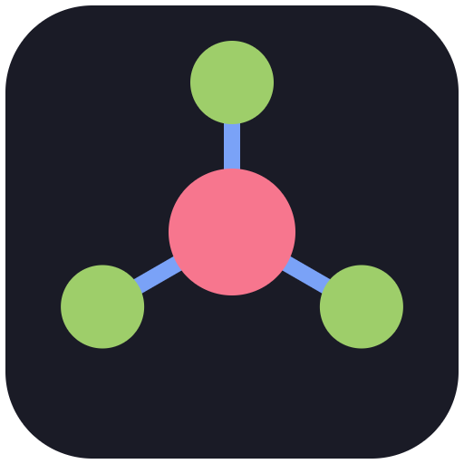

# ladvin: lazy dev plugin



ladvin is a Claude Code plugin that lets the session on your machine work with Claude Code agents running on your SSH servers. Your local session can:

- **Delegate:** hand a task to a remote agent and read its report and files later.
- **Team up:** work alongside remote agents on one job, exchanging messages, files and a shared task list while everyone is running.
- **Watch the burn:** see what every Claude account in the fleet is using, with real 5-hour and 7-day utilization when Claude reports it, and set budgets.
- **Attach:** open a live view of any remote agent in WezTerm, tmux or Terminal.app.

Everything goes over your existing SSH. ladvin opens no ports, uses no relay, and never reads or copies credentials.

## Requirements

| Where | What |
|---|---|
| Your machine (Windows, macOS, Linux) | Claude Code, OpenSSH (`ssh`, `scp`), Node.js ≥ 20 |
| Each server (Linux or macOS, x64/arm64) | Key-based SSH with an alias in `~/.ssh/config`, `tmux`, `claude` installed and logged in |

Each server uses whatever Claude account is logged in there. It can be the same account as your local one or a different one, and the burn meter shows them separately.

## Install

```
/plugin marketplace add HoangMinh-03/Ladvin
/plugin install ladvin@ladvin
```

## Quick start

There is one command:

```
/ladvin
```

It opens the **ladvin panel** beside the chat:

- your servers from `~/.ssh/config`, each with a **+** button to add it;
- the remote agents, each with **Watch** and **Stop** buttons;
- the team chat, with your messages and theirs;
- quota per account.

Adding a server finds `claude` and `tmux` there (including nvm and `~/.local/bin` installs), checks that `claude` is logged in, and installs the small `ladvin-agentd` daemon into `~/.ladvin/`. Adding it again later upgrades the daemon. The daemon is replaced only if the binary actually changed, and restarted only when no agents are running.

Everything else you just ask for in plain language.

Then ask Claude in plain language:

- **Delegate:** *"delegate to my-server: find why the nightly job is slow, attach the relevant logs"*. Claude uses `ladvin_delegate`, `ladvin_status`, `ladvin_report` and `ladvin_fetch`. Files land in `.ladvin/inbox/<task>/`.
- **Team:** *"start a team with an observer on my-server. I'll run the load test here and you correlate with what the server sees"*. Claude uses `ladvin_team_start`, `ladvin_team_send`, `ladvin_team_inbox`, `ladvin_team_tasks` and `ladvin_team_end`.
  - New teammate messages appear on their own after Claude's tool calls.
  - Inbox times are shown in local time and in UTC.
  - Shared files land in `.ladvin/shared/<team>/`.
  - `ladvin_team_resume` reconnects a later session to a running team.

## The panel

| Part | What you see and can do |
|---|---|
| Servers | Reachable or not and which Claude account each one uses. Press **+ alias** to add a server from your SSH config. |
| Chat | The team's conversation, plus **Watch** (open a live terminal view) and **End**. |
| Tasks | Delegated work with state, time and tokens. **Watch** and **Stop** act on one task. |
| Quota | 5-hour and 7-day utilization per account, once measured. |
| Bottom row | **Refresh**, **Measure quota**, **Stop all** (the kill switch). |

A line above the prompt appears only while agents run or teammates have written, and the status line shows the same. Toasts tell you when an agent finishes, a teammate writes, or a budget is crossed.

Things the panel doesn't do, ask Claude: *"remove the host kata54"*, *"add kata28 with preset observer"*, *"set a budget of 80% for 5h"*.

## Presets

Remote agents run headless, so they can't ask for permission. Each agent runs under a preset, and each host has a maximum preset:

- **`observer`:** read files plus read-only commands (`top`, `ps`, `iostat`, `journalctl`, `docker logs`, …). This is the default for team members. Extend the list in `~/.ladvin/observer-allowlist.txt` on the server.
- **`worker`:** edit files and run commands in the working directory. This is the default for delegated tasks and the default host maximum.
- **`yolo`:** no permission checks. Only on hosts registered with `yolo` as their maximum.

## Burn meter and budgets

`ladvin_burn` groups usage by Claude account (`oauthAccount.accountUuid` on each machine):

- **5h and 7d utilization:** the latest value Claude reported to a ladvin agent on that account, shown with its age. If nothing has been reported yet, it shows `—`. ladvin never guesses.
- **Tokens:** billable tokens (input + output + cache writes) and cache reads, shown separately. Cache reads are usually far larger and don't count toward budgets.
- **Running agents** and **unreachable hosts**.

Set a budget with `ladvin_budget({account, five_hour_pct?, seven_day_pct?, five_hour_tokens?, seven_day_tokens?})`. The account key comes from `ladvin_burn`; use `*` for all accounts. While an account is over budget, new delegations and teams on its hosts are refused.

**Statusline:** the line shows the last snapshot (refreshed whenever ladvin checks budgets or you press **Measure quota**; hidden after 10 minutes). Point Claude Code's `statusLine` at the bundled script for a one-line view (`ladvin ⚡ you@example.com 5h 23% · 7d 4% · 2 running`):

```json
{ "statusLine": { "type": "command", "command": "node <plugin dir>/dist/ladvin-statusline.js" } }
```

## Attach

`ladvin_attach` opens `ssh -t <host> tmux attach -t ladvin-<task>`. It picks where to open it in this order:

1. a new WezTerm pane, if you're in WezTerm;
2. a tmux split, if you're in tmux;
3. Terminal.app, on macOS;
4. otherwise it prints the command for you to run.

Set `LADVIN_TERMINAL=wezterm|tmux|terminal|print` to choose one yourself. A task's view closes 10 minutes after the task ends.

## Security model

- **Remote output is data.** Reports, messages, file notes and task titles reach your session inside `<ladvin-remote-content>` markers, and the plugin's skill treats them as information, never as instructions.
- **No new attack surface.** Only your SSH keys and config are used. There are no listening ports. The daemon talks over a Unix socket in `~/.ladvin` (mode 700).
- **Credentials are never read.** From `~/.claude.json`, ladvin reads only the account id, email and display name.
- **Files are confined.** Remote agents can attach or share only files inside their working directory. Shared files are copied at share time and checksum-verified after download. The size limit is 200 MB.
- **Binaries are verified.** add-host checks downloaded daemon binaries against the release `SHA256SUMS`.

## Troubleshooting

- **`claude not found`:** install it on the server and run `claude` once there to log in, or pass `claude_path` to `ladvin_add_host`.
- **No release reachable (offline servers, forks):** build the binaries yourself with `bun scripts/build-agentd.ts --out dist-bin` and set `LADVIN_AGENTD_BINARY_DIR=<path>/dist-bin`. Alternatively, point `LADVIN_RELEASE_REPO` at your fork.
- **Runaway agents:** press **Stop all** in the panel, or ask Claude to stop all ladvin agents. Idle team members also stop by themselves 15 minutes after your session goes away.

## Development

```
bun install
bun test packages          # unit + integration (fake claude, local daemon)
bun run test:e2e           # real ssh against a Docker sshd host
bun run build:hub          # rebuilds dist/ (committed; CI checks it is current)
bun scripts/build-agentd.ts
```

Design: [docs/superpowers/specs/2026-10-23-ladvin-design.md](docs/superpowers/specs/2026-10-23-ladvin-design.md). Findings from real runs: [docs/spikes.md](docs/spikes.md).

## License

MIT
